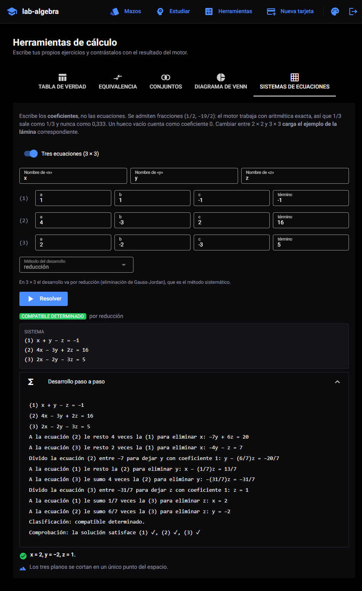
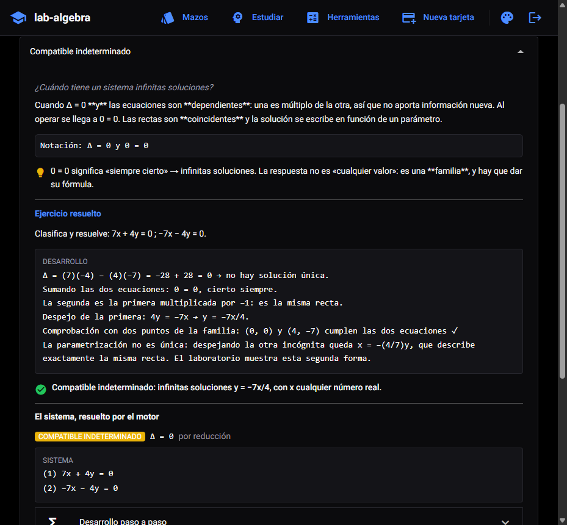
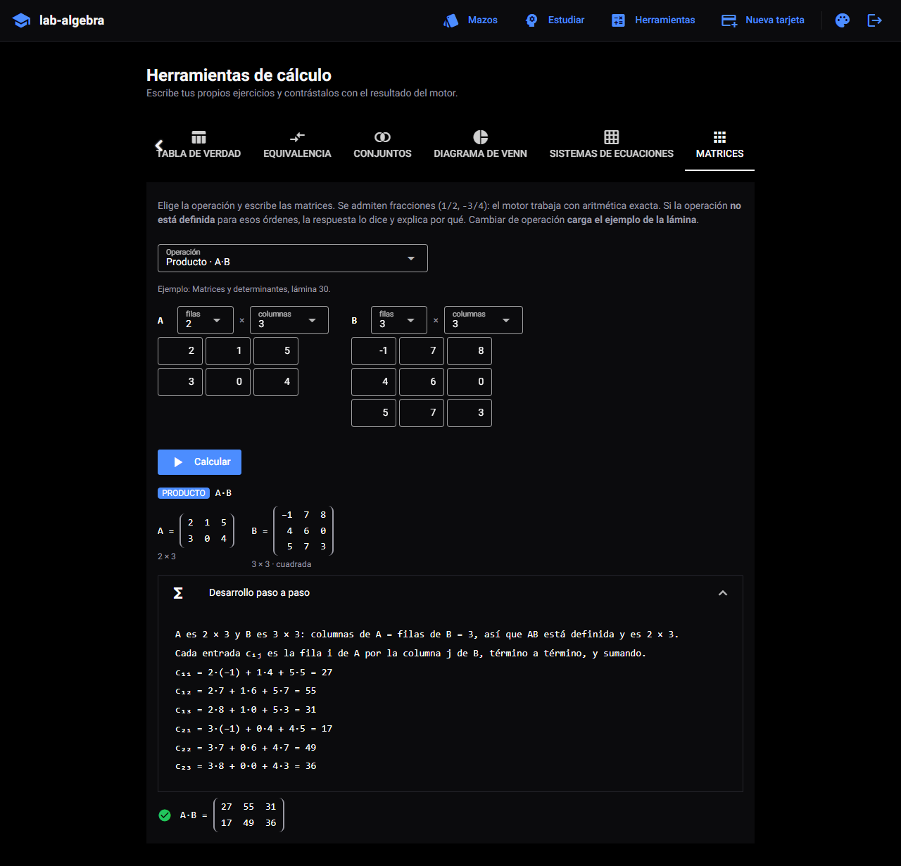
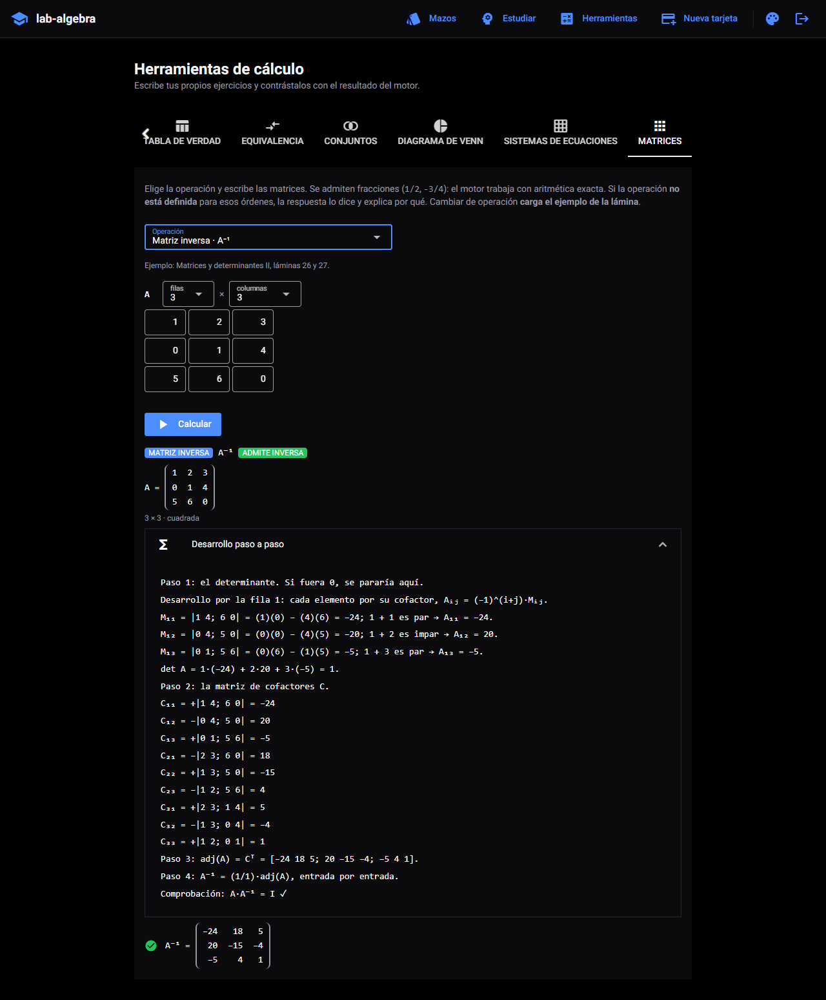
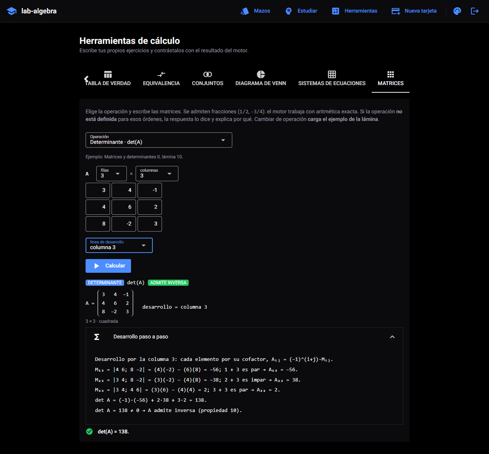
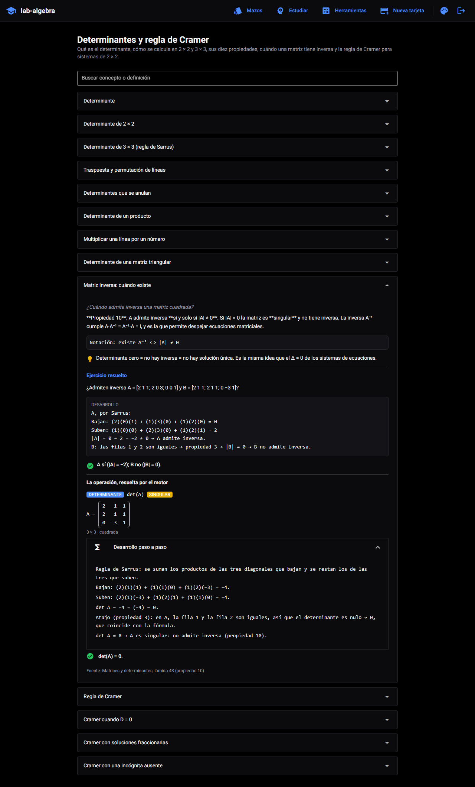

# lab-algebra — tarjetas de Álgebra que calculan, con aritmética exacta

[](https://github.com/NicolasAndresCL/lab-algebra/actions/workflows/ci.yml)


| | |
|---|---|
| **Versión** | 1.4.0 |
| **Fecha** | 20 de octubre de 2026 |
| **Autor** | [Nicolás Andrés Cano Leal](#autor) |

Laboratorio de tarjetas de memorización para la asignatura de **Álgebra**
(Universidad Santo Tomás, 2026): unidades de **lógica proposicional**,
**teoría de conjuntos**, **sistemas de ecuaciones lineales** y **matrices y
determinantes**.

No es un fichero de definiciones. Cada tarjeta trae el concepto, su notación,
una clave para recordarlo y un **ejercicio resuelto paso a paso** sacado del
material de clase — porque memorizar una definición sin verla aplicada no
sirve para rendir una prueba. Encima de eso, el laboratorio **calcula**: las
tarjetas con fórmula muestran su tabla de verdad generada en vivo, las de
conjuntos su diagrama de Venn dibujado a partir de los datos del enunciado, y
las de ecuaciones y matrices su sistema o su operación resueltos paso a paso
con **aritmética exacta** — donde la respuesta es 1/3 aparece 1/3, nunca 0,333.

---

## Contenido

- [Qué trae](#qué-trae)
- [Cómo se ve](#cómo-se-ve)
- [Temas](#temas)
- [Puesta en marcha](#puesta-en-marcha)
- [Desplegar detrás de Traefik](#desplegar-detrás-de-traefik)
- [Cómo se usa](#cómo-se-usa)
- [Arquitectura](#arquitectura)
- [El temario](#el-temario)
- [Desarrollo](#desarrollo)
- [Verificación de resultados](#verificación-de-resultados)
- [Integración continua](#integración-continua)
- [Configuración](#configuración)
- [Problemas frecuentes](#problemas-frecuentes)

---

## Qué trae

| | |
|---|---|
| **129 tarjetas** | Catorce mazos en cuatro unidades, todos con ejercicio resuelto y fuente anotada |
| **Repetición espaciada** | Variante de SM-2: lo que fallas vuelve hoy, lo que aciertas se aleja |
| **Tablas de verdad** | Analizador propio con las precedencias de la asignatura |
| **Diagramas de Venn** | matplotlib-venn, con las regiones calculadas por inclusión-exclusión |
| **Sistemas lineales** | 2×2 y 3×3 en aritmética exacta: clasificación, Δ y desarrollo por cuatro métodos, Cramer de 2×2 y 3×3 incluido |
| **Matrices** | Operaciones, tipos, menores, cofactores, determinante por cualquier fila o columna, adjunta e inversa, con numpy sobre fracciones exactas |
| **Tarjetas propias** | Se añaden desde la interfaz, sin tocar código ni reconstruir la imagen |
| **Cuatro temas** | Tres paletas oscuras y una clara, con el contraste verificado |
| **1528 pruebas** | 1477 del backend (con verificación contra sympy) y 51 de las paletas |

## Cómo se ve

| Los mazos y el progreso | Una tarjeta girada |
|---|---|
|  |  |

Una tarjeta de conjuntos, con el diagrama generado a partir de las
cardinalidades del enunciado y con los colores del tema activo:


Un sistema de 3 × 3 resuelto por la herramienta: el desarrollo es el que sale
del motor, operación por operación, y termina clasificando y comprobando la
solución en las tres ecuaciones originales.



Y la misma unidad vista desde una tarjeta: arriba el desarrollo escrito a mano
desde la lámina, debajo el que recalcula el motor. Son dos caminos
independientes hacia el mismo resultado, y si alguna vez discreparan se vería
al estudiar.



La pestaña de matrices: se elige la operación, se ajusta el orden de cada
matriz y el motor narra el producto fila por columna, entrada por entrada,
como en la lámina 30. Si la operación no está definida para esos órdenes, la
respuesta lo dice y explica por qué.



La inversa de 3 × 3 por la adjunta, con los cuatro pasos de la lámina 21
—determinante, cofactores, trasponer, dividir— y la comprobación A·A⁻¹ = I al
final:



El determinante se desarrolla **por la fila o columna que elijas**: aquí, por
la columna 3, como en la lámina 11, y da el mismo 138 que por la fila 1.



Y una tarjeta del mazo de cofactores: el desarrollo escrito a mano arriba y,
debajo, el que recalcula el motor.



## Temas

Cuatro paletas, con **tres variantes oscuras**. Se cambian desde el botón de
paleta de la cabecera, a la izquierda del de cerrar sesión, y el cambio es
**instantáneo: no recarga la página**. La elección se guarda por usuario y
sobrevive a cerrar el navegador.

| Tema | Fondo | Para qué |
|---|---|---|
| **Ónix** (por defecto) | Negro puro `#000000` | Pantallas OLED y estudiar de noche |
| **Medianoche** | Azul profundo `#0a1120` | Menos contraste; sesiones largas |
| **Carbón** | Gris cálido `#14120f` | El más suave con la vista bajo luz artificial |
| **Papel** | Claro `#f4f5f7` | Luz de día o proyectar en clase |


El tema alcanza **también a los diagramas de Venn**: el fondo y el color de los
rótulos viajan al backend, que dibuja el PNG con esos colores. Un diagrama de
fondo blanco fijo se vería como un foco encendido en mitad de una pantalla
negra.

Todo el color vive en variables CSS (`--lab-*` y las `--q-*` de Quasar), no en
clases fijas de Tailwind. Es lo que permite tener tres oscuros distintos sin
duplicar una sola clase, y evita el problema de las variantes `dark:` de
Tailwind, que responden al tema del **sistema operativo** y no al que el usuario
elige aquí.

Las paletas se prueban: `frontend/tests/test_temas.py` calcula el **contraste
WCAG** de cada combinación (texto sobre fondo, primario sobre superficie,
rótulos del Venn) y falla si baja de 4.5 para texto normal o de 3.0 para texto
grande. Una paleta ilegible no rompe nada —la página carga igual— y por eso no
la caza ningún linter.

## Puesta en marcha

Requisitos: **Docker** y **Docker Compose v2**. Nada más — ni Python ni
PostgreSQL en el equipo.

```bash
git clone https://github.com/NicolasAndresCL/lab-algebra.git
cd lab-algebra

cp .env.example .env
# Edita .env y cambia las tres claves. Para generarlas:
#   python -c "import secrets; print(secrets.token_urlsafe(48))"

docker compose up -d --build
```

Cuando los tres contenedores estén sanos (`docker compose ps`):

| Servicio | URL | Qué es |
|---|---|---|
| Interfaz | <http://localhost:8080> | La aplicación de estudio |
| API | <http://localhost:8000/docs> | Documentación interactiva de la API |
| Salud | <http://localhost:8000/healthz> | Estado de la API y de la base de datos |

Se entra con el usuario que declare tu `.env`; por defecto **`nico` / `1234`**.

Para comprobar que todo funciona de punta a punta:

```bash
bash scripts/humo.sh
```

Para apagarlo:

```bash
docker compose down       # conserva el progreso de estudio
docker compose down -v    # borra también la base de datos
```

## Desplegar detrás de Traefik

Para un servidor que **ya tiene un Traefik** en los puertos 80/443 con
Let's Encrypt (el VPS donde corre n8n). `compose.traefik.yml` se aplica
**encima** de `docker-compose.yml` y cambia cuatro cosas:

- **0 puertos publicados en el host.** Los puertos que publica Docker se saltan
  firewalld/ufw; aquí solo Traefik llega a la interfaz, por una red compartida.
- **Solo `web` se une a la red de Traefik.** La API y Postgres siguen únicamente
  en `lab-algebra-net`.
- **Basic auth de Traefik delante del login propio.** El nombre del host queda
  público en Certificate Transparency, y el login de la app sería la única
  barrera frente a bots que prueban contraseñas.
- **`mem_limit` por servicio y `ENTORNO=prod`.**

```bash
git clone --branch v1.4.0 https://github.com/NicolasAndresCL/lab-algebra.git   # en el servidor se clona el tag
cd lab-algebra

# 1. Hash de la contraseña de Traefik (se pega como usuario:hash, formato apr1)
openssl passwd -apr1 'una-contraseña-larga'

# 2. .env: las tres claves de siempre, PASSWORD_INICIAL (ver abajo) y lo nuevo
cp .env.example .env
cat >> .env <<'FIN'
LAB_ALGEBRA_HOST=algebra.<ip-con-guiones>.sslip.io
TRAEFIK_NETWORK=<red-de-traefik>
LAB_ALGEBRA_BASIC_AUTH='nico:$apr1$...$...'
COMPOSE_PATH_SEPARATOR=:
COMPOSE_FILE=docker-compose.yml:compose.traefik.yml
FIN
# TRAEFIK_NETWORK: mira el nombre con `docker network ls`.
# El hash va entre comillas simples porque lleva `$`.

# 3. Comprobar que no publica nada (debe imprimir 0)
docker compose config | grep -c published

# 4. Levantar
docker compose up -d --build --wait
```

`COMPOSE_FILE` en el `.env` es deliberado: así un `docker compose up` a secas
**nunca** levanta el stack base, que publica el 8080 y el 8000 saltándose el
firewall.

| Variable | Por defecto | Para qué |
|---|---|---|
| **`LAB_ALGEBRA_HOST`** | — obligatoria | Nombre público que enruta Traefik |
| **`TRAEFIK_NETWORK`** | — obligatoria | Red de Docker donde vive ese Traefik |
| **`LAB_ALGEBRA_BASIC_AUTH`** | — obligatoria | `usuario:hash` (`$apr1$` o bcrypt), **entre comillas simples** en el `.env` |
| `TRAEFIK_CERTRESOLVER` | `le` | Resolver ACME de ese Traefik |
| `TRAEFIK_ENTRYPOINT` | `websecure` | Entrypoint HTTPS de ese Traefik |
| `COMPOSE_PATH_SEPARATOR` / `COMPOSE_FILE` | — | `:` y `docker-compose.yml:compose.traefik.yml` |

Límites de memoria. Se midieron con `docker stats` y 30 diagramas de Venn
seguidos; como el VPS es compartido, cada límite deja ~2× de margen sobre el
pico. La última columna es el uso real tras arrancar en la prueba del 20 de
octubre:

| Servicio | Límite | Uso tras arrancar |
|---|---|---|
| `db` | 128 MiB | 58,3 MiB |
| `api` | 320 MiB | 123,7 MiB |
| `web` | 256 MiB | 88,8 MiB |

Tres cosas para no romperlo:

- **`PASSWORD_INICIAL` se define antes del primer `up`.** Solo actúa con el
  volumen vacío; después, cambiarla en el `.env` no toca el usuario existente.
- **No renombrar `container_name` ni la red `lab-algebra-net`:** la interfaz
  resuelve la API como `lab-algebra-api` y la API a Postgres como
  `lab-algebra-db`.
- **`ORIGENES_PERMITIDOS` (CORS) no importa aquí.** El navegador nunca llama a
  la API: la interfaz NiceGUI la consulta desde el servidor e incrusta los
  diagramas como data URI en base64.

Verificado en Docker Desktop con un Traefik v3.6 desechable: build y arranque
en 72 s, `docker compose ps` sin `0.0.0.0:`, 401 sin credenciales y 200 con
ellas (también en `/healthz` de la web), el login con la contraseña por defecto
rechazado (401) y con la `PASSWORD_INICIAL` nueva aceptado (200), y la web en
`lab-algebra-net` más la red de Traefik mientras la API queda solo en
`lab-algebra-net`.

## Cómo se usa

**Estudiar.** «Estudiar» reparte las tarjetas que tocan hoy: primero las que
nunca has visto, después las que vencieron. Lee el concepto, intenta responder
de memoria, gira la tarjeta y califícala en cuatro grados. Una calificación
por debajo de «Con esfuerzo» reinicia la serie y la tarjeta vuelve el mismo
día; las acertadas se alejan progresivamente (1 día, 3 días, y a partir de ahí
multiplicando por su factor de facilidad).

**Consultar.** «Mazos» lista los catorce mazos; dentro de cada uno, las tarjetas
se despliegan enteras y hay un buscador que mira tanto el concepto como la
definición. Esta es la vista para repasar la víspera de la prueba.

**Calcular.** «Herramientas» es el laboratorio propiamente dicho:

- **Tabla de verdad** de cualquier fórmula, con una columna por subfórmula y la
  clasificación (tautología / contradicción / contingencia). Acepta los
  símbolos de la asignatura y también atajos de teclado: `~` o `!`, `&` o `^`,
  `|`, `->`, `<->`.
- **Equivalencia** entre dos fórmulas, resolviendo su bicondicional.
- **Operaciones de conjuntos** (∪, ∩, −, Δ, complemento) sobre conjuntos
  escritos a mano, más las cardinalidades y el tamaño del conjunto potencia.
- **Diagramas de Venn** de dos o tres conjuntos a partir de las cardinalidades
  del enunciado: el reparto por regiones lo calcula el motor, no tú.
- **Sistemas de ecuaciones** de 2 × 2 y 3 × 3, escribiendo los coeficientes en
  una rejilla. Devuelve la clasificación (compatible determinado /
  indeterminado / incompatible), el determinante Δ en los 2 × 2, el desarrollo
  operación por operación y la lectura geométrica —rectas que se cortan,
  paralelas o coincidentes; tres planos en el espacio—. Se admiten fracciones
  (`1/2`, `-19/2`) y todo se calcula en **aritmética exacta**: nunca aparece un
  0,333 donde el enunciado dice 1/3. En 2 × 2 se puede pedir el desarrollo por
  **sustitución, igualación, reducción o la regla de Cramer** (D, Dₓ y D_y);
  en 3 × 3, por **reducción o Cramer**, que son los dos que enseña el curso
  para ese orden. El selector ofrece en cada orden solo los métodos que le
  corresponden, y la lista la sirve el backend.
- **Matrices** de hasta 4 × 4: tipo de matriz (cuadrada, identidad, diagonal,
  escalar, triangular, simétrica, antisimétrica), suma, resta, producto por un
  escalar, combinación kA + mB, producto en los dos órdenes, traspuesta, traza
  y determinante de 2 × 2 o 3 × 3; **menor** y **cofactor** de un elemento,
  **matriz de cofactores**, **adjunta** e **inversa**. Cada operación abre con
  el ejemplo de su lámina y muestra solo los campos que pide (k y m, la fila i
  y la columna j, la línea de desarrollo). El determinante de 3 × 3 se narra
  **por cofactores en la fila o columna que se elija**, como lo enseña el
  curso; Sarrus queda como opción. Dice si la matriz **admite inversa** y,
  cuando una de las propiedades del PDF permitía saber el valor sin calcularlo
  (una línea de ceros, dos iguales o proporcionales, una triangular), lo
  señala. La inversa termina comprobando que A·A⁻¹ = I, y si la matriz es
  singular responde que no existe, sin error.

**Añadir material.** «Nueva tarjeta» permite crear tarjetas y mazos propios
para las unidades que vengan después. Entran en la misma cola de repaso. Si
declaras una fórmula, un diagrama, un sistema o una operación con matrices, se
valida **al guardar**: mejor un error en el formulario que una tarjeta que
revienta en mitad de un repaso. El formulario expone la fórmula; el diagrama,
el sistema y la matriz se declaran desde el temario o por la API, que es donde
se usan.

## Arquitectura

```
                        red: lab-algebra-net
   ┌──────────────────────────────────────────────────────────┐
   │                                                          │
   │   lab-algebra              lab-algebra-api               │
   │   (NiceGUI :8080)  ──────► (FastAPI :8000)  ──────┐      │
   │   interfaz                 lógica y cálculo       │      │
   │                                                   ▼      │
   │                                        lab-algebra-db    │
   │                                        (PostgreSQL 16)   │
   └──────────────────────────────────────────────────────────┘
          ▲                          ▲
       :8080                      :8000
     (navegador)               (curl, /docs)
```

Tres contenedores, cada uno con una responsabilidad:

- **`lab-algebra`** — la interfaz NiceGUI. No sabe nada de la base de datos:
  todo lo pide por HTTP a la API. Es el contenedor que se abre en el navegador,
  y por eso se queda con el nombre corto del proyecto.
- **`lab-algebra-api`** — FastAPI. Aquí viven los motores de lógica, conjuntos,
  ecuaciones, matrices, Venn y repetición espaciada, además de la
  autenticación. Las cuatro unidades comparten contenedor a propósito: son módulos de cálculo sin estado
  propio ni dependencias distintas, y un servicio por unidad multiplicaría
  healthchecks y entradas de red sin separar nada que estuviera junto por error.
- **`lab-algebra-db`** — PostgreSQL 16. **No publica el 5432 al host**: nada
  fuera de la red necesita hablar con ella, y exponerla sería abrir una
  superficie inútil.

Mantener la API separada de la interfaz es lo que permite levantar solo el
backend —para `/docs`, para un script, para un notebook de la asignatura— sin
arrastrar NiceGUI.

### Por dentro del backend

```
backend/app/
├── main.py            arranque: routers, CORS, creación del esquema y semilla
├── config.py          ajustes tipados desde el entorno (pydantic-settings)
├── modelos.py         Usuario · Mazo · Tarjeta · Repaso
├── excepciones.py     errores de dominio con su código y su HTTP
├── manejadores.py     único punto que traduce excepción → respuesta
├── seguridad.py       bcrypt + JWT
├── routers/           auth · mazos · herramientas · estudio · salud
├── services/          ← la lógica de verdad, sin HTTP ni base de datos
│   ├── logica.py      analizador y tablas de verdad
│   ├── conjuntos.py   operaciones e inclusión-exclusión
│   ├── numeros.py     fracciones exactas: lectura y escritura compartidas
│   ├── ecuaciones.py  sistemas lineales exactos, su clasificación y Cramer 2×2/3×3
│   ├── matrices.py    operaciones, tipos, cofactores, inversa (numpy + Fraction)
│   ├── venn.py        diagramas en PNG
│   └── repaso.py      repetición espaciada
└── seed/              el temario, en Python plano
```

Los servicios no importan FastAPI ni SQLAlchemy: se prueban llamándolos
directamente, sin levantar nada.

`matrices.py` está escrito de forma **declarativa**: los tipos de matriz, los
requisitos de cada operación, los parámetros que pide, las operaciones y los
atajos del determinante son registros de datos (`TIPOS`, `PARAMETROS`,
`OPERACIONES`, `ATAJOS`) y no cadenas de `if`. Añadir una operación es añadir
una entrada; la interfaz la muestra sola, con sus campos, porque construye el
formulario a partir de `GET /herramientas/matrices/operaciones`. Lo mismo vale
para los métodos de resolver sistemas: `METODOS_POR_ORDEN` en `ecuaciones.py`,
publicado en `GET /herramientas/ecuaciones/metodos`.

El determinante se **calcula** siempre igual —desarrollo de Laplace,
`determinante()`— y se **narra** como pida el usuario: por cofactores en
cualquier línea o, si se elige, por Sarrus. Un test comprueba que las seis
líneas dan el mismo valor y que la suma escrita en la narración, reevaluada,
coincide con el cálculo.
Las matrices son arrays de **numpy** con `dtype=object` y entradas `Fraction`:
se aprovecha el álgebra vectorizada (`A @ B`, `A.T`, `np.trace`, `np.tril`)
sin perder exactitud. `np.linalg.det` queda fuera a propósito: trabaja en coma
flotante, y un determinante que vale 0 saldría como 1e−16, que es justo la
pregunta de la unidad («¿admite inversa?»).

### Por dentro de la interfaz

```
frontend/app/
├── main.py            ui.run() y registro de las páginas
├── config.py          ajustes tipados desde el entorno
├── api.py             cliente HTTP del backend; traduce el contrato de error
├── estado.py          sesión del usuario en app.storage.user
├── temas.py           ← las cuatro paletas y el gestor que las aplica
├── componentes.py     cabecera, selector de tema, tabla, diagrama, sistema, matriz
└── paginas/           login · inicio · estudiar · herramientas · nueva
    └── tarjeta.py     render compartido por el listado y el estudio
```

La interfaz no habla nunca con la base de datos: todo pasa por `api.py`.

### Contrato de error

Todos los errores salen con la misma forma, venga de donde venga el fallo:

```json
{"error": {"codigo": "formula_invalida",
           "mensaje": "Carácter no reconocido '$' en la posición 4.",
           "detalle": {"posicion": 4}}}
```

El `codigo` es el identificador estable que consume la interfaz; el `mensaje`
es texto en español que puede cambiar sin romper nada.

## El temario

| Mazo | Unidad | Tarjetas | Fuente |
|---|---|---:|---|
| Lógica proposicional — fundamentos | Lógica | 7 | Clases 1 y 2 de Lógica |
| Conectivos lógicos | Lógica | 8 | Clases 1 y 2; Test Acumulativo N.º 1 |
| Tablas de verdad y clasificación | Lógica | 11 | Clase 3; Tarea-Taller 1; Test Acumulativo N.º 1 |
| Conjuntos — fundamentos | Conjuntos | 11 | Clase 1 de Conjuntos |
| Operaciones y álgebra de conjuntos | Conjuntos | 8 | Clase 1 de Conjuntos |
| Cardinalidad e inclusión-exclusión | Conjuntos | 7 | Clase 2 de Conjuntos 2026 |
| Sistemas lineales — fundamentos | Ecuaciones | 7 | Sistemas de ecuaciones 2×2 y 3×3 |
| Métodos de resolución 2 × 2 | Ecuaciones | 7 | Sistemas 2×2; Sistemas y aplicaciones |
| Clasificación y sistemas 3 × 3 | Ecuaciones | 7 | Sistemas 2×2, lámina 14; Sistemas 3×3, láminas 4 y 5 |
| Matrices — fundamentos | Matrices | 9 | Matrices y determinantes, láminas 2 a 18 |
| Tipos de matrices | Matrices | 7 | Matrices y determinantes, láminas 5 a 20 |
| Operaciones con matrices | Matrices | 12 | Matrices y determinantes, láminas 21 a 34 |
| Determinantes y regla de Cramer | Matrices | 13 | Matrices y determinantes, láminas 35 a 47 |
| Cofactores, inversa y Cramer 3 × 3 | Matrices | 15 | Matrices y determinantes II, láminas 1 a 27 |
| | | **129** | |

«Matrices y determinantes» es el archivo `Matrices-Determinantes.pdf` de la
asignatura; «Matrices y determinantes II», el `Matrices-determ.pdf`.

Cada tarjeta guarda la lámina exacta de la que sale, de modo que cualquier duda
se resuelve volviendo al PDF y no discutiendo con la aplicación.

Cada unidad cubre lo que se enseñó y **solo** lo que se enseñó. La de
ecuaciones: los tres métodos, la clasificación, la interpretación geométrica y
el Δ de 2 × 2. La de matrices: tipos, operaciones, ecuaciones matriciales,
determinantes de 2 × 2 y 3 × 3 con sus diez propiedades, menores, cofactores,
la adjunta, la inversa por la adjunta y la regla de Cramer de 2 × 2 y de
3 × 3, que entra como cuarto método del motor de ecuaciones. No hay rangos, ni
inversa por Gauss-Jordan, ni determinantes de orden mayor que 3 como
operación: ninguno de los dos PDF los enseña. El criterio de qué entra es el
temario, no lo que sea técnicamente posible.

El primer PDF de matrices daba determinantes de 3 × 3 sin enseñar el método, y
la v1.2.0 los narraba con la **regla de Sarrus**. El segundo PDF enseña el
**desarrollo por cofactores**, así que desde la v1.3.0 esa es la narración por
defecto; Sarrus sigue disponible como opción y su tarjeta dice que es un atajo
que solo vale en 3 × 3.

En Cramer de 3 × 3 hay un matiz que el laboratorio respeta: con D = 0, que Dₓ,
D_y y D_z valgan también 0 **no** garantiza infinitas soluciones (tres planos
paralelos lo desmienten), a diferencia del 2 × 2. Por eso el desarrollo no los
calcula en ese caso y deja decidir a la eliminación; hay un test con ese
contraejemplo.

La carga es **idempotente**: se ejecuta en cada arranque, corrige el texto de
las tarjetas del temario si cambió y **nunca toca una tarjeta creada por el
usuario**. Corregir una errata solo exige reiniciar el servicio; el progreso de
estudio no se pierde.

El arranque además **pone el esquema al día** antes de sembrar: `create_all`
crea las tablas que faltan pero nunca añade una columna a una tabla que ya
existe, así que actualizar el laboratorio conservando el volumen de datos
—donde vive tu progreso— moriría en la primera consulta. Las columnas añadidas
después de la v1.0.0 están declaradas en `app/db.py` y se aplican solas.

## Desarrollo

Para trabajar sin Docker hacen falta Python 3.12+ y un PostgreSQL (o SQLite,
que basta para los tests).

```bash
python -m venv .venv
.venv/Scripts/activate            # Windows;  source .venv/bin/activate en Linux

pip install -r backend/requirements-dev.txt
pip install -r frontend/requirements-dev.txt
```

Levantar cada mitad por separado:

```bash
# Terminal 1 — API (SQLite basta para desarrollo)
cd backend
SECRET_KEY="una-clave-de-al-menos-32-caracteres-aqui" \
DATABASE_URL="sqlite:///./local.sqlite3" \
python -m uvicorn app.main:app --reload --port 8000

# Terminal 2 — interfaz
cd frontend
API_URL="http://127.0.0.1:8000" STORAGE_SECRET="clave-de-sesion-local" \
python -m app.main
```

Antes de commitear:

```bash
bash scripts/verificar.sh             # lint + tests + cobertura (~15 s)
bash scripts/verificar.sh --completo  # además: build y arranque en Docker
```

`verificar.sh` corre **lo mismo que el CI y en el mismo orden**. El job que
siempre se olvida es el que no se reproduce a mano; por eso está aquí también
el que levanta el stack entero.

`requirements.txt` se regenera con `pip freeze`, **no se edita a mano**. Si
instalas algo para resolver una tarea, congélalo en la misma sesión.

### Añadir tarjetas al temario

Una tarjeta nueva es una entrada más en el diccionario de
`backend/app/seed/contenido_logica.py`, `contenido_conjuntos.py`,
`contenido_ecuaciones.py` o `contenido_matrices.py`. No hace falta tocar nada más: la carga las recoge
sola. Los campos obligatorios son `concepto`, `pregunta`, `definicion`,
`ejercicio_enunciado`, `ejercicio_desarrollo`, `ejercicio_respuesta` y
`fuente`; los tests fallan si falta alguno.

Una tarjeta puede además declarar contenido **calculado**, que el laboratorio
recalcula en vivo al mostrarla:

| Campo | Qué añade | Resultado esperado que hay que escribir |
|---|---|---|
| `formula` | La tabla de verdad de la fórmula | `CLASIFICACIONES_ESPERADAS` |
| `venn` | El diagrama de Venn del enunciado | `REGIONES_DOS_ESPERADAS` y los tests de tres conjuntos |
| `sistema` | El sistema resuelto paso a paso | `SISTEMAS_ESPERADOS` |
| `matriz` | La operación con matrices resuelta paso a paso | `MATRICES_ESPERADAS` |

Los cuatro diccionarios viven en `tests/test_contenido.py` y sus valores se
**leen del PDF o se resuelven a mano desde la lámina**, nunca se copian de lo
que devuelve el programa: copiarlos haría que el test se comparara consigo
mismo. En el caso de `sistema` y de `matriz` hay además un test que falla si
añades una tarjeta sin su resultado esperado —o si queda un esperado
huérfano—, porque una disciplina que depende de acordarse no es una
disciplina.

`matriz` lleva la misma forma que el cuerpo de `POST /herramientas/matrices`:
`{"operacion": "producto", "a": [[…]], "b": [[…]]}`, más los parámetros que
pida la operación: `k` y `m` (escalares), `i` y `j` (fila y columna en base 1,
para menores y cofactores) o `desarrollo` (`"fila 2"`, `"columna 3"`,
`"Sarrus"`). Las operaciones disponibles y lo que pide cada una están en
`GET /herramientas/matrices/operaciones`.

Los coeficientes de `sistema` y las entradas de `matriz` se escriben como
entero o como **texto**
(`"1/2"`, `"-19/2"`), nunca como número con coma: un `0.333` guardado en la
base ya no se puede volver a leer como el 1/3 que decía el enunciado, y hay un
test que lo prohíbe.

## Verificación de resultados

Un error en una tarjeta se memoriza mal y se arrastra hasta la prueba, así que
ningún resultado se da por bueno con una sola fuente. Hay tres capas:

1. **El motor propio** calcula la tabla o las regiones.
2. **sympy** las recalcula por un camino independiente
   (`tests/test_verificacion_sympy.py`). No comparte una línea con el motor: usa
   `Implies`, `Equivalent`, `And`, `Or`, `Not`, `Xor` y **otro algoritmo de
   análisis** (shunting-yard). Usar otro analizador, y no solo otra librería de
   evaluación, es deliberado — si ambos caminos compartieran el parser, un error
   de precedencia pasaría inadvertido en los dos.
3. **Los valores del PDF**, escritos a mano en `tests/test_contenido.py` y
   contrastados contra lo que calculan los motores.

En la unidad de ecuaciones las tres capas se concretan así: el motor resuelve
por Gauss-Jordan; los 66 sistemas del banco de ejercicios de la carpeta de
apuntes —ya verificados con sympy por un camino independiente— se contrastaron
uno a uno contra él, coincidiendo en clasificación, solución y Δ; y cada
tarjeta lleva en `SISTEMAS_ESPERADOS` su resultado resuelto a mano desde la
lámina. Encima de eso, toda solución única se **sustituye en el sistema
original** y sus residuos tienen que dar cero: es la comprobación que no
depende de nadie, ni siquiera de la clave impresa en el PDF, que también se
equivoca.

En la unidad de matrices: el motor calcula con numpy sobre fracciones;
`tests/test_matrices.py` repite cada operación con `sympy.Matrix` sobre más de
mil matrices aleatorias (con semilla fija, para que un fallo sea
reproducible) y exige coincidencia exacta; comprueba en miles de casos que
cada atajo del determinante predice el mismo valor que la fórmula, que es lo
que afirma la propiedad; y las 32 tarjetas con `matriz` llevan su resultado
esperado tomado de la lámina, que en esta unidad casi siempre trae la
respuesta impresa. Un tercer test exige que la respuesta escrita a mano de cada
tarjeta **cite** el mismo resultado que calcula el motor. Las igualdades de
matrices con incógnitas (láminas 7 y 8) se resuelven aparte con `sympy.solve`.
Y la regla de Cramer se contrastó contra los 34 sistemas de 2 × 2 del banco de
la carpeta de apuntes: coincide con la reducción en todos.

La segunda parte añade sus propias comprobaciones: menores, matriz de
cofactores, adjunta e inversa contra `sympy` (`minor`, `cofactor_matrix`,
`adjugate`, `inv`) en cientos de matrices aleatorias; toda inversa calculada
se multiplica por A y tiene que dar la identidad; Cramer de 3 × 3 coincide con
la reducción en 300 sistemas al azar. Las 16 claves impresas en el segundo
PDF se comprobaron con sympy antes de escribir una sola tarjeta, y estaban
todas bien.

Además, las funciones de conteo **rechazan regiones negativas**: un enunciado
mal copiado no puede producir un diagrama imposible con una respuesta creíble.
Y el motor de ecuaciones **rechaza los coeficientes con coma**: aceptar 0,333
donde el enunciado dice 1/3 convertiría un sistema compatible indeterminado en
uno determinado con una solución inventada, porque un pivote que vale
exactamente cero saldría como 1e−17.

## Integración continua

`.github/workflows/ci.yml`, en cascada rápido → lento:

| Job | Qué comprueba |
|---|---|
| `lint` | `ruff` sobre backend y frontend, más `docker compose config --quiet` sobre `compose.traefik.yml` exigiendo **0 puertos publicados** |
| `test` | pytest del backend con SQLite, cobertura mínima del 90 % |
| `test-frontend` | contraste WCAG de las cuatro paletas |
| `test-postgres` | la misma suite contra PostgreSQL 16 real |
| `build` | las dos imágenes Docker construyen |
| `arranque` | el stack levanta, queda sano y pasa la prueba de humo |

El último job es el que justifica el pipeline: comprueba que el laboratorio
**inicia sesión, sirve el temario de las cuatro unidades y calcula** —una
tabla de verdad, un reparto de Venn, un sistema con fracciones, sistemas por
Cramer de 2 × 2 y de 3 × 3, un determinante con fracciones y una inversa— de
punta a punta. Un
CI que solo lintea da falsa seguridad.

La prueba de humo comprueba también que un sistema con coeficiente `1/2` vuelve
con `y = 1/2` exacto, que un producto de matrices no definido **responde 200
con `definida: false`** y que un sistema **incompatible responde 200**: «no tiene
solución» es una de las tres clasificaciones de la unidad, no un fallo de la
API, y confundirlo sería un error de dominio disfrazado de error de red.

Los permisos están declarados como `contents: read`; sin ese bloque se hereda
el default del repositorio, que a veces es `write` global.

## Configuración

Todo por variables de entorno; nada quemado en el código. Ver `.env.example`.

| Variable | Por defecto | Para qué |
|---|---|---|
| `POSTGRES_USER` / `POSTGRES_DB` | `algebra` | Credenciales de la base |
| `POSTGRES_PASSWORD` | — **obligatoria** | Compose falla ruidoso si falta |
| `SECRET_KEY` | — **obligatoria** | Firma los JWT. Mínimo 32 caracteres |
| `STORAGE_SECRET` | — **obligatoria** | Firma la cookie de sesión de NiceGUI |
| `USUARIO_INICIAL` | `nico` | Usuario que se crea en el primer arranque |
| `PASSWORD_INICIAL` | `1234` | Su contraseña |
| `ENTORNO` | `dev` | `dev` \| `test` \| `prod` |
| `PUERTO_WEB` / `PUERTO_API` | `8080` / `8000` | Puertos publicados en el host (el override de Traefik los quita) |
| `LAB_ALGEBRA_HOST`, `TRAEFIK_NETWORK`, `LAB_ALGEBRA_BASIC_AUTH`, `TRAEFIK_CERTRESOLVER`, `TRAEFIK_ENTRYPOINT` | — | Solo para [desplegar detrás de Traefik](#desplegar-detrás-de-traefik) |

`SECRET_KEY` exige 32 caracteres porque es el mínimo que la RFC 7518 §3.2
recomienda para HS256; por debajo, PyJWT avisa en cada firma.

`USUARIO_INICIAL` y `PASSWORD_INICIAL` solo actúan en el **primer** arranque:
cambiarlas después no modifica el usuario que ya existe en la base.

## Problemas frecuentes

**«No se pudo contactar con la API» en la pantalla de login.**
La interfaz está viva pero la API no responde. `docker compose ps` y
`docker compose logs api`. Lo más habitual es que Postgres tardara en aceptar
conexiones; el `depends_on: service_healthy` lo cubre, pero si la máquina va
justa conviene subir el `start_period` del healthcheck.

**El contenedor `lab-algebra-api` sale como `unhealthy`.**
El healthcheck consulta la base de datos, así que un `unhealthy` casi siempre
significa que Postgres no está respondiendo, no que la API esté rota.
`docker compose logs db`.

**`define SECRET_KEY en tu .env` al hacer `docker compose up`.**
Falta el `.env` o la variable. Es intencional: Compose falla ruidoso en vez de
arrancar con una clave débil. `cp .env.example .env` y edita las tres claves.

**Los números de los diagramas salen como rectángulos vacíos.**
Faltan las fuentes en la imagen. El `Dockerfile` instala `fonts-dejavu-core`
justamente para eso; si tocaste esa línea, vuelve a ponerla.

**Cambié una tarjeta del temario y no la veo.**
La carga se ejecuta al arrancar: `docker compose restart api`. Si la tarjeta la
creaste desde la interfaz, la semilla no la toca nunca — edítala desde la
interfaz.

**Actualicé el laboratorio y la API no arranca, con un error de columna.**
No debería pasar: el arranque pone el esquema al día antes de sembrar. Si ves
`UndefinedColumn` o `no such column`, es que se añadió una columna al modelo
sin declararla en `COLUMNAS_ANADIDAS` de `backend/app/db.py` — añádela ahí y
reinicia. El log de la API lo dice cuando sí funciona:
`Columna «tarjetas.matriz» añadida al esquema existente` (o `tarjetas.sistema`
si vienes de una versión anterior a la 1.1.0). Borrar el volumen
también «arregla» el síntoma, pero se lleva todo el progreso de estudio por
delante; no es el camino.

**Un sistema con 1/2 me devuelve 0.5 o un error al resolverlo.**
El motor trabaja sin redondeos y **rechaza los números con coma** a propósito.
Escribe la fracción (`1/2`, `-19/2`) o el decimal como texto (`0.5`, que
`Fraction` convierte exactamente a 1/2). Si escribiste `0.333` esperando 1/3,
el error es correcto: no son el mismo número, y en esta unidad la diferencia
cambia la clasificación del sistema.

**Elegí un tema y al volver aparece otro.**
El tema se guarda en `app.storage.user`, que NiceGUI respalda con una cookie
firmada por `STORAGE_SECRET`. Si esa variable cambia entre arranques, las
cookies anteriores dejan de validar y la sesión —tema incluido— vuelve al
punto de partida. Fija `STORAGE_SECRET` en el `.env` y no la regeneres.

**Tras correr `verificar.sh --completo` ya no veo los contenedores.**
El script apaga el stack al terminar **solo si no estaba levantado antes**; si
lo estaba, lo deja como lo encontró. En cualquier caso el volumen
`lab-algebra-datos` se conserva —el `down` va sin `-v`— así que el progreso de
estudio no se pierde. Para volver a levantarlo: `docker compose up -d`.

**`Bind for 0.0.0.0:8080 failed: port is already allocated`.**
Otro servicio del equipo —un Jenkins, otro NiceGUI— ya usa el 8080. No hace
falta pararlo: `PUERTO_WEB=8081 docker compose up -d` publica la interfaz en el
8081, y la prueba de humo y `verificar.sh` leen la misma variable
(`PUERTO_WEB=8081 bash scripts/verificar.sh --completo`). Para dejarlo fijo,
cámbialo en tu `.env`.

**Una operación con matrices dice «no está definida» y no da resultado.**
No es un fallo: es la respuesta. Sumar un 2 × 3 con un 3 × 2, multiplicar
cuando las columnas de A no coinciden con las filas de B o pedir la traza de
una matriz no cuadrada son operaciones que no existen, y el desarrollo explica
qué orden no encaja. El error (422) queda para lo mal escrito: filas de
distinta longitud o un número ilegible.

**Quiero empezar el progreso de cero.**
`docker compose down -v` borra el volumen `lab-algebra-datos` y con él todo el
historial de repasos. El temario se vuelve a cargar solo en el siguiente
arranque.

---

## Licencia y alcance

Material de estudio personal de la asignatura de Álgebra (ST 2026): lógica
proposicional, teoría de conjuntos, sistemas de ecuaciones lineales y matrices
y determinantes. Los
enunciados de los ejercicios provienen de las clases y evaluaciones de la
asignatura y se citan con su lámina de origen.

---

## Autor

**Nicolás Andrés Cano Leal**\
Backend Engineer → SRE | Python · Django · Kubernetes · Terraform · CI/CD

- LinkedIn: [linkedin.com/in/nicolasandrescl](https://www.linkedin.com/in/nicolasandrescl/)
- Portafolio: [nicolasandrescl.github.io](https://nicolasandrescl.github.io/)
- Correo: [nicolas.cano.leal@gmail.com](mailto:nicolas.cano.leal@gmail.com)

lab-algebra v1.4.0 · 20 de octubre de 2026
