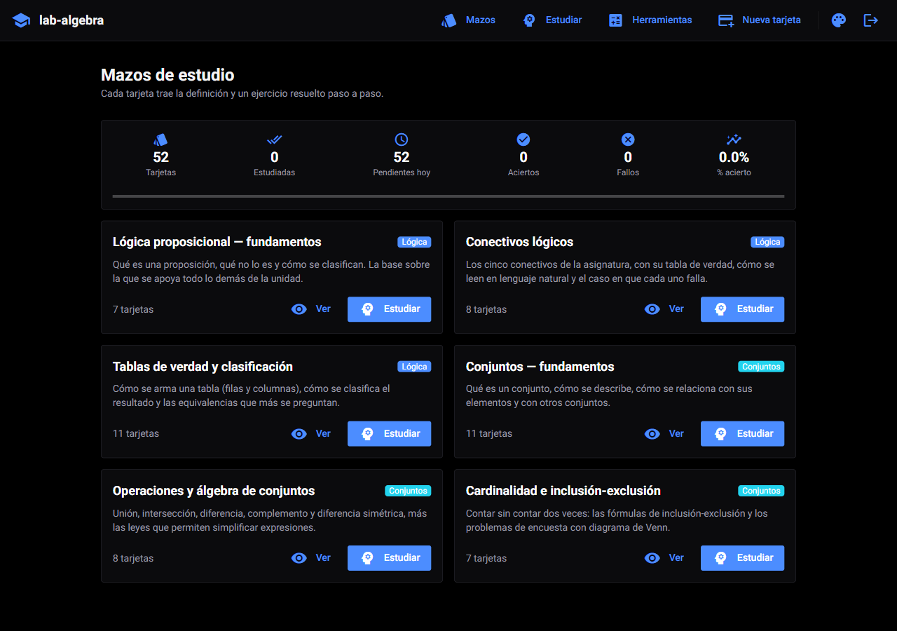
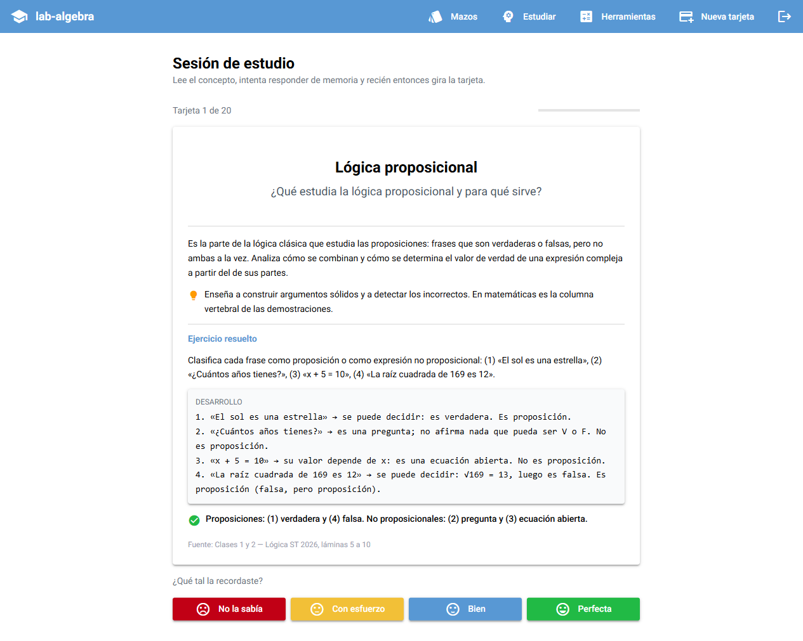
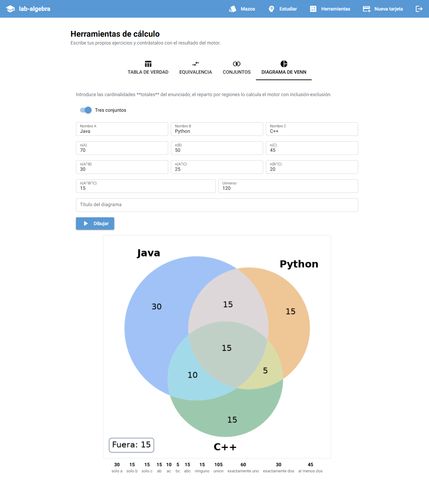
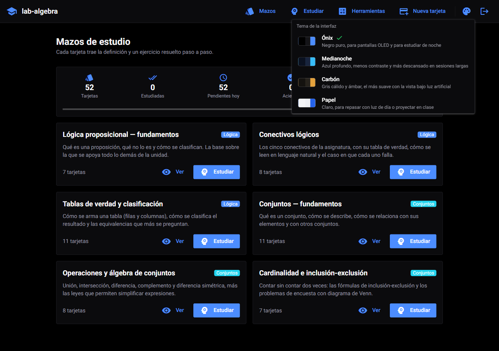

# lab-algebra

[](https://github.com/NicolasAndresCL/lab-algebra/actions/workflows/ci.yml)

Laboratorio de tarjetas de memorización para la asignatura de **Álgebra**
(Universidad Santo Tomás, 2026): unidades de **lógica proposicional** y
**teoría de conjuntos**.

No es un fichero de definiciones. Cada tarjeta trae el concepto, su notación,
una clave para recordarlo y un **ejercicio resuelto paso a paso** sacado del
material de clase — porque memorizar una definición sin verla aplicada no
sirve para rendir una prueba. Encima de eso, el laboratorio **calcula**: las
tarjetas con fórmula muestran su tabla de verdad generada en vivo, y las de
conjuntos su diagrama de Venn dibujado a partir de los datos del enunciado.

---

## Contenido

- [Qué trae](#qué-trae)
- [Cómo se ve](#cómo-se-ve)
- [Temas](#temas)
- [Puesta en marcha](#puesta-en-marcha)
- [Cómo se usa](#cómo-se-usa)
- [Arquitectura](#arquitectura)
- [El temario](#el-temario)
- [Desarrollo](#desarrollo)
- [Verificación de resultados](#verificación-de-resultados)
- [Integración continua](#integración-continua)
- [Configuración](#configuración)
- [Problemas frecuentes](#problemas-frecuentes)

---

## Qué trae

| | |
|---|---|
| **52 tarjetas** | Seis mazos, todos con ejercicio resuelto y fuente anotada |
| **Repetición espaciada** | Variante de SM-2: lo que fallas vuelve hoy, lo que aciertas se aleja |
| **Tablas de verdad** | Analizador propio con las precedencias de la asignatura |
| **Diagramas de Venn** | matplotlib-venn, con las regiones calculadas por inclusión-exclusión |
| **Tarjetas propias** | Se añaden desde la interfaz, sin tocar código ni reconstruir la imagen |
| **Cuatro temas** | Tres paletas oscuras y una clara, con el contraste verificado |
| **425 pruebas** | 374 del backend (con verificación contra sympy) y 51 de las paletas |

## Cómo se ve

| Los mazos y el progreso | Una tarjeta girada |
|---|---|
|  |  |

Una tarjeta de conjuntos, con el diagrama generado a partir de las
cardinalidades del enunciado y con los colores del tema activo:



## Temas

Cuatro paletas, con **tres variantes oscuras**. Se cambian desde el botón de
paleta de la cabecera, a la izquierda del de cerrar sesión, y el cambio es
**instantáneo: no recarga la página**. La elección se guarda por usuario y
sobrevive a cerrar el navegador.

| Tema | Fondo | Para qué |
|---|---|---|
| **Ónix** (por defecto) | Negro puro `#000000` | Pantallas OLED y estudiar de noche |
| **Medianoche** | Azul profundo `#0a1120` | Menos contraste; sesiones largas |
| **Carbón** | Gris cálido `#14120f` | El más suave con la vista bajo luz artificial |
| **Papel** | Claro `#f4f5f7` | Luz de día o proyectar en clase |



El tema alcanza **también a los diagramas de Venn**: el fondo y el color de los
rótulos viajan al backend, que dibuja el PNG con esos colores. Un diagrama de
fondo blanco fijo se vería como un foco encendido en mitad de una pantalla
negra.

Todo el color vive en variables CSS (`--lab-*` y las `--q-*` de Quasar), no en
clases fijas de Tailwind. Es lo que permite tener tres oscuros distintos sin
duplicar una sola clase, y evita el problema de las variantes `dark:` de
Tailwind, que responden al tema del **sistema operativo** y no al que el usuario
elige aquí.

Las paletas se prueban: `frontend/tests/test_temas.py` calcula el **contraste
WCAG** de cada combinación (texto sobre fondo, primario sobre superficie,
rótulos del Venn) y falla si baja de 4.5 para texto normal o de 3.0 para texto
grande. Una paleta ilegible no rompe nada —la página carga igual— y por eso no
la caza ningún linter.

## Puesta en marcha

Requisitos: **Docker** y **Docker Compose v2**. Nada más — ni Python ni
PostgreSQL en el equipo.

```bash
git clone <url-del-repositorio>
cd lab-algebra

cp .env.example .env
# Edita .env y cambia las tres claves. Para generarlas:
#   python -c "import secrets; print(secrets.token_urlsafe(48))"

docker compose up -d --build
```

Cuando los tres contenedores estén sanos (`docker compose ps`):

| Servicio | URL | Qué es |
|---|---|---|
| Interfaz | <http://localhost:8080> | La aplicación de estudio |
| API | <http://localhost:8000/docs> | Documentación interactiva de la API |
| Salud | <http://localhost:8000/healthz> | Estado de la API y de la base de datos |

Se entra con el usuario que declare tu `.env`; por defecto **`nico` / `1234`**.

Para comprobar que todo funciona de punta a punta:

```bash
bash scripts/humo.sh
```

Para apagarlo:

```bash
docker compose down       # conserva el progreso de estudio
docker compose down -v    # borra también la base de datos
```

## Cómo se usa

**Estudiar.** «Estudiar» reparte las tarjetas que tocan hoy: primero las que
nunca has visto, después las que vencieron. Lee el concepto, intenta responder
de memoria, gira la tarjeta y califícala en cuatro grados. Una calificación
por debajo de «Con esfuerzo» reinicia la serie y la tarjeta vuelve el mismo
día; las acertadas se alejan progresivamente (1 día, 3 días, y a partir de ahí
multiplicando por su factor de facilidad).

**Consultar.** «Mazos» lista los seis mazos; dentro de cada uno, las tarjetas
se despliegan enteras y hay un buscador que mira tanto el concepto como la
definición. Esta es la vista para repasar la víspera de la prueba.

**Calcular.** «Herramientas» es el laboratorio propiamente dicho:

- **Tabla de verdad** de cualquier fórmula, con una columna por subfórmula y la
  clasificación (tautología / contradicción / contingencia). Acepta los
  símbolos de la asignatura y también atajos de teclado: `~` o `!`, `&` o `^`,
  `|`, `->`, `<->`.
- **Equivalencia** entre dos fórmulas, resolviendo su bicondicional.
- **Operaciones de conjuntos** (∪, ∩, −, Δ, complemento) sobre conjuntos
  escritos a mano, más las cardinalidades y el tamaño del conjunto potencia.
- **Diagramas de Venn** de dos o tres conjuntos a partir de las cardinalidades
  del enunciado: el reparto por regiones lo calcula el motor, no tú.

**Añadir material.** «Nueva tarjeta» permite crear tarjetas y mazos propios
para las unidades que vengan después. Entran en la misma cola de repaso. Si
declaras una fórmula o un diagrama, se valida **al guardar**: mejor un error en
el formulario que una tarjeta que revienta en mitad de un repaso.

## Arquitectura

```
                        red: lab-algebra-net
   ┌──────────────────────────────────────────────────────────┐
   │                                                          │
   │   lab-algebra              lab-algebra-api               │
   │   (NiceGUI :8080)  ──────► (FastAPI :8000)  ──────┐      │
   │   interfaz                 lógica y cálculo       │      │
   │                                                   ▼      │
   │                                        lab-algebra-db    │
   │                                        (PostgreSQL 16)   │
   └──────────────────────────────────────────────────────────┘
          ▲                          ▲
       :8080                      :8000
     (navegador)               (curl, /docs)
```

Tres contenedores, cada uno con una responsabilidad:

- **`lab-algebra`** — la interfaz NiceGUI. No sabe nada de la base de datos:
  todo lo pide por HTTP a la API. Es el contenedor que se abre en el navegador,
  y por eso se queda con el nombre corto del proyecto.
- **`lab-algebra-api`** — FastAPI. Aquí viven los motores de lógica, conjuntos,
  Venn y repetición espaciada, además de la autenticación.
- **`lab-algebra-db`** — PostgreSQL 16. **No publica el 5432 al host**: nada
  fuera de la red necesita hablar con ella, y exponerla sería abrir una
  superficie inútil.

Mantener la API separada de la interfaz es lo que permite levantar solo el
backend —para `/docs`, para un script, para un notebook de la asignatura— sin
arrastrar NiceGUI.

### Por dentro del backend

```
backend/app/
├── main.py            arranque: routers, CORS, creación del esquema y semilla
├── config.py          ajustes tipados desde el entorno (pydantic-settings)
├── modelos.py         Usuario · Mazo · Tarjeta · Repaso
├── excepciones.py     errores de dominio con su código y su HTTP
├── manejadores.py     único punto que traduce excepción → respuesta
├── seguridad.py       bcrypt + JWT
├── routers/           auth · mazos · herramientas · estudio · salud
├── services/          ← la lógica de verdad, sin HTTP ni base de datos
│   ├── logica.py      analizador y tablas de verdad
│   ├── conjuntos.py   operaciones e inclusión-exclusión
│   ├── venn.py        diagramas en PNG
│   └── repaso.py      repetición espaciada
└── seed/              el temario, en Python plano
```

Los servicios no importan FastAPI ni SQLAlchemy: se prueban llamándolos
directamente, sin levantar nada.

### Por dentro de la interfaz

```
frontend/app/
├── main.py            ui.run() y registro de las páginas
├── config.py          ajustes tipados desde el entorno
├── api.py             cliente HTTP del backend; traduce el contrato de error
├── estado.py          sesión del usuario en app.storage.user
├── temas.py           ← las cuatro paletas y el gestor que las aplica
├── componentes.py     cabecera, selector de tema, tabla, diagrama
└── paginas/           login · inicio · estudiar · herramientas · nueva
    └── tarjeta.py     render compartido por el listado y el estudio
```

La interfaz no habla nunca con la base de datos: todo pasa por `api.py`.

### Contrato de error

Todos los errores salen con la misma forma, venga de donde venga el fallo:

```json
{"error": {"codigo": "formula_invalida",
           "mensaje": "Carácter no reconocido '$' en la posición 4.",
           "detalle": {"posicion": 4}}}
```

El `codigo` es el identificador estable que consume la interfaz; el `mensaje`
es texto en español que puede cambiar sin romper nada.

## El temario

| Mazo | Unidad | Tarjetas | Fuente |
|---|---|---:|---|
| Lógica proposicional — fundamentos | Lógica | 7 | Clases 1 y 2 de Lógica |
| Conectivos lógicos | Lógica | 8 | Clases 1 y 2; Test Acumulativo N.º 1 |
| Tablas de verdad y clasificación | Lógica | 11 | Clase 3; Tarea-Taller 1; Test Acumulativo N.º 1 |
| Conjuntos — fundamentos | Conjuntos | 11 | Clase 1 de Conjuntos |
| Operaciones y álgebra de conjuntos | Conjuntos | 8 | Clase 1 de Conjuntos |
| Cardinalidad e inclusión-exclusión | Conjuntos | 7 | Clase 2 de Conjuntos 2026 |
| | | **52** | |

Cada tarjeta guarda la lámina exacta de la que sale, de modo que cualquier duda
se resuelve volviendo al PDF y no discutiendo con la aplicación.

La carga es **idempotente**: se ejecuta en cada arranque, corrige el texto de
las tarjetas del temario si cambió y **nunca toca una tarjeta creada por el
usuario**. Corregir una errata solo exige reiniciar el servicio; el progreso de
estudio no se pierde.

## Desarrollo

Para trabajar sin Docker hacen falta Python 3.12+ y un PostgreSQL (o SQLite,
que basta para los tests).

```bash
python -m venv .venv
.venv/Scripts/activate            # Windows;  source .venv/bin/activate en Linux

pip install -r backend/requirements-dev.txt
pip install -r frontend/requirements-dev.txt
```

Levantar cada mitad por separado:

```bash
# Terminal 1 — API (SQLite basta para desarrollo)
cd backend
SECRET_KEY="una-clave-de-al-menos-32-caracteres-aqui" \
DATABASE_URL="sqlite:///./local.sqlite3" \
python -m uvicorn app.main:app --reload --port 8000

# Terminal 2 — interfaz
cd frontend
API_URL="http://127.0.0.1:8000" STORAGE_SECRET="clave-de-sesion-local" \
python -m app.main
```

Antes de commitear:

```bash
bash scripts/verificar.sh             # lint + tests + cobertura (~15 s)
bash scripts/verificar.sh --completo  # además: build y arranque en Docker
```

`verificar.sh` corre **lo mismo que el CI y en el mismo orden**. El job que
siempre se olvida es el que no se reproduce a mano; por eso está aquí también
el que levanta el stack entero.

`requirements.txt` se regenera con `pip freeze`, **no se edita a mano**. Si
instalas algo para resolver una tarea, congélalo en la misma sesión.

### Añadir tarjetas al temario

Una tarjeta nueva es una entrada más en el diccionario de
`backend/app/seed/contenido_logica.py` o `contenido_conjuntos.py`. No hace
falta tocar nada más: la carga las recoge sola. Los campos obligatorios son
`concepto`, `pregunta`, `definicion`, `ejercicio_enunciado`,
`ejercicio_desarrollo`, `ejercicio_respuesta` y `fuente`; los tests fallan si
falta alguno.

Si la tarjeta lleva `formula`, añade su clasificación esperada al diccionario
`CLASIFICACIONES_ESPERADAS` de `tests/test_contenido.py` **leyéndola del PDF**,
no de lo que devuelva el programa. Ese es el sentido de la comprobación.

## Verificación de resultados

Un error en una tarjeta se memoriza mal y se arrastra hasta la prueba, así que
ningún resultado se da por bueno con una sola fuente. Hay tres capas:

1. **El motor propio** calcula la tabla o las regiones.
2. **sympy** las recalcula por un camino independiente
   (`tests/test_verificacion_sympy.py`). No comparte una línea con el motor: usa
   `Implies`, `Equivalent`, `And`, `Or`, `Not`, `Xor` y **otro algoritmo de
   análisis** (shunting-yard). Usar otro analizador, y no solo otra librería de
   evaluación, es deliberado — si ambos caminos compartieran el parser, un error
   de precedencia pasaría inadvertido en los dos.
3. **Los valores del PDF**, escritos a mano en `tests/test_contenido.py` y
   contrastados contra lo que calculan los motores.

Además, las funciones de conteo **rechazan regiones negativas**: un enunciado
mal copiado no puede producir un diagrama imposible con una respuesta creíble.

## Integración continua

`.github/workflows/ci.yml`, en cascada rápido → lento:

| Job | Qué comprueba |
|---|---|
| `lint` | `ruff` sobre backend y frontend |
| `test` | pytest del backend con SQLite, cobertura mínima del 90 % |
| `test-frontend` | contraste WCAG de las cuatro paletas |
| `test-postgres` | la misma suite contra PostgreSQL 16 real |
| `build` | las dos imágenes Docker construyen |
| `arranque` | el stack levanta, queda sano y pasa la prueba de humo |

El último job es el que justifica el pipeline: comprueba que el laboratorio
**inicia sesión, sirve el temario y calcula una tabla de verdad** de punta a
punta. Un CI que solo lintea da falsa seguridad.

Los permisos están declarados como `contents: read`; sin ese bloque se hereda
el default del repositorio, que a veces es `write` global.

## Configuración

Todo por variables de entorno; nada quemado en el código. Ver `.env.example`.

| Variable | Por defecto | Para qué |
|---|---|---|
| `POSTGRES_USER` / `POSTGRES_DB` | `algebra` | Credenciales de la base |
| `POSTGRES_PASSWORD` | — **obligatoria** | Compose falla ruidoso si falta |
| `SECRET_KEY` | — **obligatoria** | Firma los JWT. Mínimo 32 caracteres |
| `STORAGE_SECRET` | — **obligatoria** | Firma la cookie de sesión de NiceGUI |
| `USUARIO_INICIAL` | `nico` | Usuario que se crea en el primer arranque |
| `PASSWORD_INICIAL` | `1234` | Su contraseña |
| `ENTORNO` | `dev` | `dev` \| `test` \| `prod` |
| `PUERTO_WEB` / `PUERTO_API` | `8080` / `8000` | Puertos publicados en el host |

`SECRET_KEY` exige 32 caracteres porque es el mínimo que la RFC 7518 §3.2
recomienda para HS256; por debajo, PyJWT avisa en cada firma.

`USUARIO_INICIAL` y `PASSWORD_INICIAL` solo actúan en el **primer** arranque:
cambiarlas después no modifica el usuario que ya existe en la base.

## Problemas frecuentes

**«No se pudo contactar con la API» en la pantalla de login.**
La interfaz está viva pero la API no responde. `docker compose ps` y
`docker compose logs api`. Lo más habitual es que Postgres tardara en aceptar
conexiones; el `depends_on: service_healthy` lo cubre, pero si la máquina va
justa conviene subir el `start_period` del healthcheck.

**El contenedor `lab-algebra-api` sale como `unhealthy`.**
El healthcheck consulta la base de datos, así que un `unhealthy` casi siempre
significa que Postgres no está respondiendo, no que la API esté rota.
`docker compose logs db`.

**`define SECRET_KEY en tu .env` al hacer `docker compose up`.**
Falta el `.env` o la variable. Es intencional: Compose falla ruidoso en vez de
arrancar con una clave débil. `cp .env.example .env` y edita las tres claves.

**Los números de los diagramas salen como rectángulos vacíos.**
Faltan las fuentes en la imagen. El `Dockerfile` instala `fonts-dejavu-core`
justamente para eso; si tocaste esa línea, vuelve a ponerla.

**Cambié una tarjeta del temario y no la veo.**
La carga se ejecuta al arrancar: `docker compose restart api`. Si la tarjeta la
creaste desde la interfaz, la semilla no la toca nunca — edítala desde la
interfaz.

**Elegí un tema y al volver aparece otro.**
El tema se guarda en `app.storage.user`, que NiceGUI respalda con una cookie
firmada por `STORAGE_SECRET`. Si esa variable cambia entre arranques, las
cookies anteriores dejan de validar y la sesión —tema incluido— vuelve al
punto de partida. Fija `STORAGE_SECRET` en el `.env` y no la regeneres.

**Quiero empezar el progreso de cero.**
`docker compose down -v` borra el volumen `lab-algebra-datos` y con él todo el
historial de repasos. El temario se vuelve a cargar solo en el siguiente
arranque.

---

## Licencia y alcance

Material de estudio personal de la asignatura de Álgebra (ST 2026). Los
enunciados de los ejercicios provienen de las clases y evaluaciones de la
asignatura y se citan con su lámina de origen.
